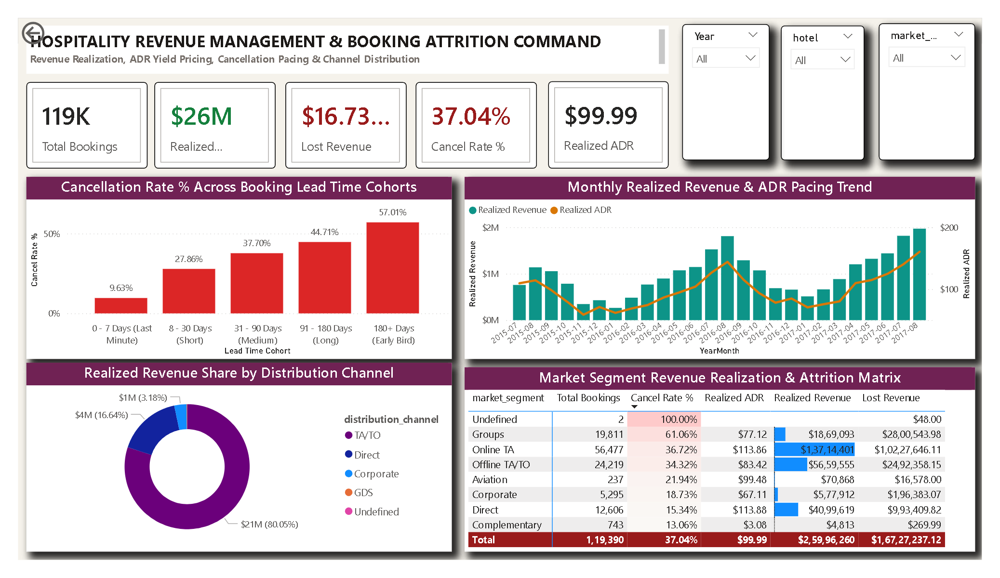

<div align="center">

# 🏨 Day 24: Hospitality Revenue Management & Booking Attrition Command

**Hotel Inventory Economics, ADR Pricing Yield, Cancellation Pacing & Distribution Channel Revenue Realization**

[](https://powerbi.microsoft.com/)
[](https://learn.microsoft.com/en-us/dax/)
[](https://en.wikipedia.org/wiki/Revenue_management)
[](https://www.kaggle.com/datasets/sriharshaeedala/airline-delay)

<br/>



</div>

---

## 📁 Repository & File Manifest

```text
Day24 - Hospitality-Revenue-Management-Booking-Cancellation/
│
├── 📊 Hospitality_Revenue_Management_Cancellations.pbix  # Production Power BI Application & Star Schema Model
├── 📄 hotel_bookings.csv                                # Raw Booking Records (119,390 reservations × 32 features)
├── 🖼️ dashboard_preview.png                             # High-Resolution Executive Dashboard Screenshot
└── 📝 README.md                                         # Full Project Architecture, DAX Formulas & Strategic Playbook
```

### File Details & Data Footprint
| File Name | File Type | File Size | Description |
| :--- | :---: | :---: | :--- |
| **`Hospitality_Revenue_Management_Cancellations.pbix`** | Power BI Report | ~3.9 MB | Hospitality yield model, DAX revenue suite, Nordic Sand editorial UI, and pacing matrices. |
| **`hotel_bookings.csv`** | CSV Data Source | 4.4 MB | 119,390 audited reservation records spanning City and Resort hotels (July 2015 – August 2017). |
| **`dashboard_preview.png`** | Image (PNG) | ~1.1 MB | High-resolution canvas view used for documentation and portfolio showcases. |
| **`README.md`** | Markdown Document | ~14 KB | Comprehensive hospitality problem statement, revenue yield benchmarks, DAX formulas, and reproduction steps. |

---

## 📌 Executive Summary

This hospitality revenue management command center analyzes room inventory allocation, dynamic pricing realization, and booking attrition velocity across **119,390 guest reservations** spanning City and Resort hotel properties. Over a 26-month operational window, the system generated **$42.72M in gross potential booking demand**, successfully realizing **$26.00M in net room revenue** while losing **$16.73M (39.15% of gross revenue)** to booking cancellations and no-shows.

> [!IMPORTANT]
> **Operational Yield Takeaway:** Overall portfolio cancellation sits at **37.04% (44,224 bookings)**. Cancellation risk is heavily driven by booking lead time: reservations made **0–7 days before arrival cancel at just 9.63%**, whereas reservations made **>180 days in advance cancel at 57.01%**. Long-horizon bookings generate a false sense of inventory security while exposing hotels to high holding losses.

---

## 📊 Core Hospitality & Revenue Benchmarks

| Strategic Hospitality Metric | Portfolio Benchmark Value | Industry & Operational Meaning |
| :--- | :---: | :--- |
| **Total Reservations Booked** | **`119,390` Bookings** | Cumulative gross room reservations received across all channels. |
| **Net Realized Stays** | **`75,166` Stays (62.96%)** | Fulfilled guest reservations with confirmed check-out status. |
| **Total Canceled Bookings** | **`44,224` Bookings** | Bookings canceled prior to arrival or recorded as No-Show. |
| **Portfolio Cancellation Rate %** | **`37.04%`** | Macro reservation attrition rate across all channels. |
| **Gross Realized Room Revenue** | **`$25,996,260.41` ($26.00M)** | Net earned room revenue collected from fulfilled stays. |
| **Surrendered Cancellation Loss** | **`$16,727,237.12` ($16.73M)** | Revenue capacity eliminated by cancellations. |
| **Total Potential Revenue Pool** | **`$42,723,497.53` ($42.72M)** | Gross potential booking value prior to cancellations. |
| **Realized Average Daily Rate (ADR)**| **`$99.99` / Night** | Mean room rate realized per fulfilled room night. |
| **Average Length of Stay (ALOS)** | **`3.43` Nights** | Mean duration per guest reservation. |
| **Total Room Nights Booked** | **`409,257` Nights** | Cumulative room inventory nights demanded. |
| **Average Booking Lead Time** | **`104.01` Days (~3.5 Mos)** | Mean elapsed window between reservation creation and check-in. |
| **Early-Bird Cancellation Cliff** | **`57.01%` (180+ Days)** | Advance reservations cancel at **nearly 6x** the rate of last-minute bookings. |

---

## 🧱 Data Architecture & Feature Engineering

The data model uses a clean star schema linking transactional reservations (`HotelBookings`) to a continuous date dimension (`DimDate`).

```
                  ┌───────────────────────────────┐
                  │            DimDate            │
                  │   (Continuous Date Matrix)    │
                  └───────────────┬───────────────┘
                                  │ 1
                                  │ *
                  ┌───────────────┴───────────────┐
                  │         HotelBookings         │
                  │   (119,390 Booking Records)   │
                  └───────────────────────────────┘
```

### 1. Data Schema & Field Reference
| Field Name | Type | Description | Engineering Transformation |
| :--- | :---: | :--- | :--- |
| `hotel` | Text | Property Classification | `City Hotel` vs. `Resort Hotel` |
| `is_canceled` | Whole Number | Cancellation Flag (1 = Canceled, 0 = Realized) | Primary attrition indicator |
| `lead_time` | Whole Number | Days Between Booking & Arrival Date | Binned into 5 operational cohorts |
| `arrival_date_year`, `month`, `day` | Integer / Text | Arrival Date Components | Synthesized into discrete `ArrivalDate` |
| `stays_in_weekend_nights` | Whole Number | Weekend Room Nights | Added to week nights for `Total Nights` |
| `stays_in_week_nights` | Whole Number | Weekday Room Nights | Added to weekend nights for `Total Nights` |
| `adults`, `children`, `babies` | Whole Number | Guest Party Demographics | Replaced 4 `"NA"` strings in `children` with `0` |
| `country` | Text | Guest Origin Country (ISO Code) | Replaced `null` with `"Unknown"` |
| `market_segment` | Text | Demand Segmentation Channel | `Online TA`, `Offline TA`, `Groups`, `Direct`, etc. |
| `distribution_channel` | Text | Intermediary Distribution Route | `TA/TO`, `Direct`, `Corporate`, `GDS` |
| `adr` | Decimal | Average Daily Rate charged per night ($) | Core pricing measure |
| `Total Nights` | Whole Number | Total Stay Duration (Nights) | Calculated: `[stays_in_weekend_nights] + [stays_in_week_nights]` |
| `Booking Revenue` | Decimal | Gross Potential Booking Value ($) | Calculated: `[Total Nights] * [adr]` |
| `Lead Time Cohort` | Text | Lead Time Bracket | `0 - 7 Days`, `8 - 30 Days`, `31 - 90 Days`, `91 - 180 Days`, `180+ Days` |

### 2. Power Query M Transformations
```powerquery
// 1. Synthesize Continuous Arrival Date
= Table.AddColumn(#"Changed Type", "ArrivalDate", each 
    #date([arrival_date_year], Date.Month(Date.FromText("2000-" & [arrival_date_month] & "-01")), [arrival_date_day_of_month]), type date)

// 2. Compute Total Stay Nights
= Table.AddColumn(#"Added ArrivalDate", "Total Nights", each [stays_in_weekend_nights] + [stays_in_week_nights], Int64.Type)

// 3. Compute Gross Booking Revenue
= Table.AddColumn(#"Added Total Nights", "Booking Revenue", each [Total Nights] * [adr], type number)

// 4. Handle Text Type Errors in Children
= Table.ReplaceErrorValues(#"Added Revenue", {{"children", 0}})
```

---

## 📐 Complete DAX Measure Library

All measures are cataloged in an independent measure table (`_Measures`):

### 1. Booking Volume & Fulfillment Measures

```dax
// Total audited reservation records
Total Bookings = 
COUNTROWS(HotelBookings)
```

```dax
// Canceled reservations and no-shows
Canceled Bookings = 
CALCULATE(
    COUNTROWS(HotelBookings),
    HotelBookings[is_canceled] = 1
)
```

```dax
// Successfully fulfilled guest stays
Realized Stays = 
CALCULATE(
    COUNTROWS(HotelBookings),
    HotelBookings[is_canceled] = 0
)
```

```dax
// Portfolio booking cancellation rate %
Cancellation Rate % = 
DIVIDE(
    [Canceled Bookings], 
    [Total Bookings], 
    0
)
```

### 2. Revenue Management & Yield Measures

```dax
// Gross potential booking revenue pool
Gross Potential Revenue = 
SUM(HotelBookings[Booking Revenue])
```

```dax
// Net earned revenue from fulfilled guest stays
Realized Revenue = 
CALCULATE(
    [Gross Potential Revenue],
    HotelBookings[is_canceled] = 0
)
```

```dax
// Surrendered room revenue lost to cancellations
Lost Revenue to Cancellations = 
CALCULATE(
    [Gross Potential Revenue],
    HotelBookings[is_canceled] = 1
)
```

```dax
// Mean room rate across fulfilled stays
Realized ADR = 
CALCULATE(
    AVERAGE(HotelBookings[adr]),
    HotelBookings[is_canceled] = 0
)
```

---

## 🎯 Market Segment & Distribution Diagnostics

### 1. Market Segment Performance Matrix
| Market Segment | Bookings | Cancel Rate % | Realized ADR | Realized Revenue ($) | Lost Revenue ($) | Yield Profile |
| :--- | :---: | :---: | :---: | :---: | :---: | :--- |
| **Online TA** | 56,477 | 36.72% | **$113.86** | **$13.71M** | $10.23M | **Primary Volume Engine:** High yield, moderate cancellation risk. |
| **Offline TA/TO** | 24,219 | 34.32% | $83.42 | **$5.66M** | $2.49M | Stable contracted tour operator volume. |
| **Groups** | 19,811 | **61.06%** | $77.12 | $1.87M | **$2.80M** | **Extreme Risk Hotspot:** Heavy block cancellations erode yield. |
| **Direct** | 12,606 | **15.34%** | **$113.88** | **$4.10M** | $0.99M | **Highest Profitability:** Lowest cancellation, premium ADR. |
| **Corporate** | 5,295 | 18.73% | $67.11 | $0.58M | $0.20M | Consistent mid-week corporate occupancy. |
| **Aviation** | 237 | 21.94% | $99.48 | $0.07M | $0.02M | Airline crew contract stays. |

### 2. Lead Time Cancellation Pacing Curve
| Lead Time Bracket | Total Bookings | Cancel Rate % | Realized Stays | Strategic Assessment |
| :---: | :---: | :---: | :---: | :--- |
| **0 – 7 Days (Last Minute)** | 19,746 | **9.63%** | 17,844 | **Committed Travelers:** Near-zero cancellation risk. |
| **8 – 30 Days (Short)** | 18,960 | 27.86% | 13,677 | Typical vacation booking window. |
| **31 – 90 Days (Medium)** | 29,553 | 37.70% | 18,412 | Approaching portfolio baseline churn. |
| **91 – 180 Days (Long)** | 26,439 | 44.71% | 14,618 | Elevated speculative booking horizon. |
| **180+ Days (Early Bird)** | 24,692 | **57.01%** | 10,615 | **The Attrition Cliff:** Over half of early bookings cancel. |

---

## 💡 Strategic Executive Insights

1. **The Early-Bird Booking Mirage (57% Cancellation Cliff):** Bookings created more than 180 days in advance cancel at a **57.01% rate**, compared to just **9.63% for last-minute bookings (<7 days)**. Securing early demand is essential for pacing, but relying on long-horizon uncommitted bookings without non-refundable deposit terms creates artificial inventory scarcity that blocks higher-paying last-minute travelers.
2. **The Direct Booking Advantage (15.3% Churn at $113.88 ADR):** Direct website bookings generate the highest net realization in the portfolio: an **ADR of $113.88** paired with the **lowest cancellation rate (15.34%)**. Investing in loyalty incentives and direct booking discounts directly protects margin compared to Online Travel Agencies (`Online TA`), which carry higher cancellation exposure (36.72%) plus 15–20% commission cuts.
3. **Group Reservation Vulnerability (61% Cancellation):** Group reservations experience an attrition rate of **61.06%**, losing $2.80M in revenue. Implementing staged non-refundable deposit schedules (e.g., 30% at 90 days, 50% at 30 days) is critical to curbing speculative block holding.

---

## 📥 Dataset Source & Setup Guide

* **Source:** [Kaggle - Hotel Booking Demand by Jesse Mostipak](https://www.kaggle.com/datasets/jessemostipak/hotel-booking-demand)
* **File Used:** `hotel_bookings.csv` (119,390 rows × 32 columns)

### Reproduction Steps:
1. Clone or download this project repository:
   ```bash
   git clone [https://github.com/yusufehtesham29/30-Days-Of-Power-BI.git](https://github.com/yusufehtesham29/30-Days-Of-Power-BI.git)
   cd "Day24 - Hospitality-Revenue-Management-Booking-Cancellation"
   ```
2. Verify that `hotel_bookings.csv` is present in the folder.
3. Open `Hospitality_Revenue_Management_Cancellations.pbix` in **Power BI Desktop**.
4. If prompted to reconnect the data source:
   * Go to **Home > Transform Data > Data source settings**.
   * Click **Change Source**, point to your local `hotel_bookings.csv`, and click **Close & Apply**.

---

<div align="center">

Developed as part of the **30-Day Enterprise Power BI Portfolio Challenge**.

[Back to Master Repository](https://github.com/yusufehtesham29/30-Days-Of-Power-BI)

</div>
