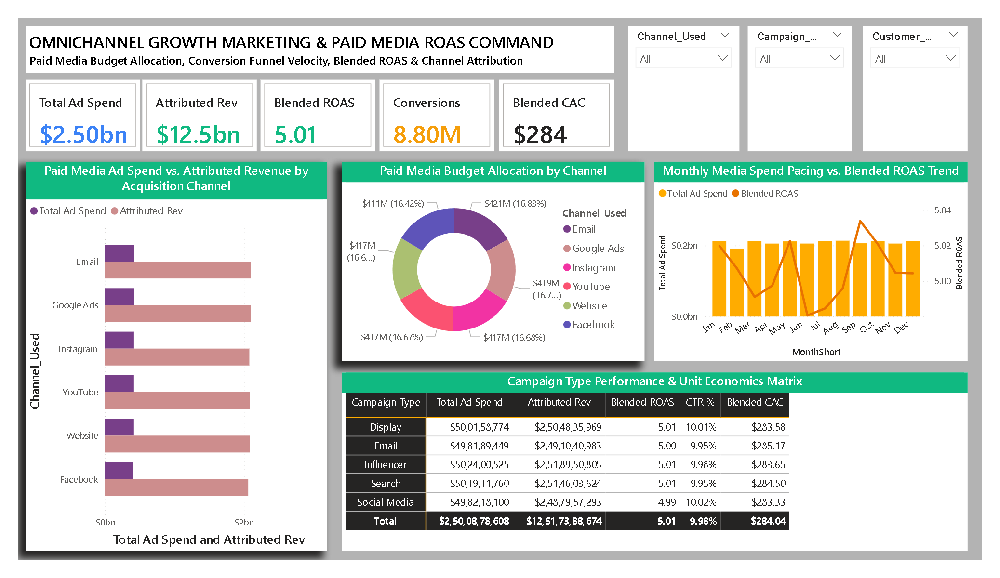

<div align="center">

# 📈 Day 25: Omnichannel Growth Marketing & Paid Media ROAS Command

**Enterprise Growth Marketing, Paid Acquisition Efficiency, Blended ROAS & Conversion Funnel Unit Economics**

[](https://powerbi.microsoft.com/)
[](https://learn.microsoft.com/en-us/dax/)
[](https://en.wikipedia.org/wiki/Digital_marketing)
[](https://www.kaggle.com/)

<br/>



</div>

---

## 📁 Repository & File Manifest

```text
Day25 - Omnichannel-Growth-Marketing-ROAS-Analytics/
│
├── 📊 Omnichannel_Growth_Marketing_ROAS.pbix  # Production Power BI Application & Data Model
├── 📄 marketing_campaign_dataset.csv          # Raw Campaign Records (200,000 campaigns × 16 features)
├── 🖼️ dashboard_preview.png                  # High-Resolution Executive Dashboard Screenshot
└── 📝 README.md                              # Full Project Architecture, DAX Formulas & Growth Playbook
```

### File Details & Data Footprint
| File Name | File Type | File Size | Description |
| :--- | :---: | :---: | :--- |
| **`Omnichannel_Growth_Marketing_ROAS.pbix`** | Power BI Report | ~3.8 MB | Interactive marketing analytics application, DAX efficiency suite, and channel attribution matrix. |
| **`marketing_campaign_dataset.csv`** | CSV Data Source | 26.0 MB | 200,000 enterprise campaign records executed across 5 brands and 6 acquisition channels in 2021. |
| **`dashboard_preview.png`** | Image (PNG) | ~1.1 MB | High-resolution canvas view used for documentation and portfolio showcases. |
| **`README.md`** | Markdown Document | ~14 KB | Comprehensive growth marketing problem statement, unit economics benchmarks, DAX formulas, and reproduction steps. |

---

## 📌 Executive Summary

This enterprise growth marketing command center evaluates paid acquisition efficiency, customer acquisition unit economics, and multi-channel attribution across **200,000 digital marketing campaigns** spanning 5 corporate brands in 2021. With an aggregate media investment of **$2.50 Billion in paid ad spend**, the portfolio delivered **1.10 Billion impressions**, driving **109.95 Million site clicks** and **8.80 Million attributed customer conversions**.

> [!IMPORTANT]
> **Marketing Efficiency Takeaway:** Across all 6 media channels, the portfolio generated **$12.52 Billion in gross attributed revenue**, translating to a **Blended ROAS of 5.01x ($5.01 revenue realized per $1.00 ad spend)** and a net margin post-ad spend of **$10.02 Billion**. Unit acquisition economics remained controlled with a **Blended CAC of $284.04** against an average **CPC of $22.74** and an **8.01% conversion rate**.

---

## 📊 Core Growth & Unit Economics Benchmarks

| Strategic Marketing Metric | Baseline Portfolio Benchmark | Growth & Operational Significance |
| :--- | :---: | :--- |
| **Total Monitored Campaigns** | **`200,000` Campaigns** | Audited digital marketing initiatives across 5 corporate brands. |
| **Total Paid Media Ad Spend** | **`$2,500,878,608.00` ($2.50B)** | Cumulative capital deployed across all paid acquisition channels. |
| **Attributed Campaign Revenue** | **`$12,517,388,674.24` ($12.52B)** | Gross realized customer revenue generated (`Spend * ROI`). |
| **Net Profit Post-Ad Spend** | **`$10,016,510,066.24` ($10.02B)** | Contribution margin retained after deducting direct ad spend. |
| **Blended Portfolio ROAS** | **`5.01x` ($5.01 per $1.00)** | Gross return on ad spend across all media channels. |
| **Total Digital Impressions** | **`1,101,460,304` (1.10B)** | Aggregate ad exposures delivered across search, display, and social. |
| **Total Inbound Traffic Clicks** | **`109,954,406` (109.95M)** | Click-through visitors routed to product landing pages. |
| **Total Attributed Conversions** | **`8,804,580` (8.80M)** | Completed conversions (`Clicks * Conversion_Rate`). |
| **Average Click-Through Rate (CTR)**| **`9.98%`** | Overall ad engagement and creative resonance benchmark. |
| **Average Cost Per Click (CPC)** | **`$22.74`** | Unit cost per inbound qualified visitor. |
| **Cost Per Acquisition (CPA / CAC)**| **`$284.04`** | Blended paid advertising spend required to acquire one converting customer. |
| **Conversion Rate (CVR %)** | **`8.01%`** | Overall conversion efficiency from landing page click to transaction. |

---

## 🧱 Data Architecture & Feature Engineering

The underlying model combines a cleaned campaign fact table (`MarketingCampaigns`) linked to an automated continuous DAX Calendar table (`DimDate`).

```
                  ┌───────────────────────────────┐
                  │            DimDate            │
                  │   (Continuous Date Matrix)    │
                  └───────────────┬───────────────┘
                                  │ 1
                                  │ *
                  ┌───────────────┴───────────────┐
                  │      MarketingCampaigns       │
                  │   (200,000 Campaign Records)  │
                  └───────────────────────────────┘
```

### 1. Data Schema & Field Reference
| Field Name | Type | Description | Engineering Transformation |
| :--- | :---: | :--- | :--- |
| `Campaign_ID` | Whole Number | Unique Campaign Identifier | Primary key for distinct marketing campaigns |
| `Company` | Text | Advertising Brand Entity | 5 corporate enterprise entities |
| `Campaign_Type` | Text | Tactical Media Channel | `Search`, `Display`, `Social Media`, `Influencer`, `Email` |
| `Target_Audience` | Text | Audience Demographic Bracket | `Men 18-24`, `Women 25-34`, `Women 35-44`, etc. |
| `Duration` | Text | Campaign Run Window | `15 days`, `30 days`, `45 days`, `60 days` |
| `Channel_Used` | Text | Media Platform Execution | `Google Ads`, `Facebook`, `Instagram`, `YouTube`, `Email`, `Website` |
| `Conversion_Rate`| Decimal | On-Page CVR | Used to derive `Conversions = Clicks * Conversion_Rate` |
| `Acquisition_Cost`| Decimal | Total Campaign Spend | Stripped currency symbol `$` and commas, cast to Decimal |
| `ROI` | Decimal | Campaign Return Multiplier | Multiplied by ad spend to derive `Attributed Revenue` |
| `Clicks` | Whole Number | Total Inbound Traffic | Inbound visits driven by campaign |
| `Impressions` | Whole Number | Total Ad Exposures | Ad view volume across networks |
| `Customer_Segment`| Text | Behavioral Category | `Tech Enthusiasts`, `Fashionistas`, `Foodies`, etc. |
| `Date` | Date | Campaign Launch Date | Linked to `DimDate[Date]` |

---

## 📐 Complete DAX Measure Library

All measures are cataloged in an independent measure table (`_Measures`):

### 1. Media Spend & Revenue Realization

```dax
// Cumulative paid media ad spend
Total Ad Spend = 
SUM(MarketingCampaigns[Acquisition_Cost])
```

```dax
// Total customer revenue attributed to marketing campaigns
Attributed Revenue = 
SUM(MarketingCampaigns[Attributed Revenue])
```

```dax
// Net contribution margin post-media spend
Net Profit Post-Ad Spend = 
[Attributed Revenue] - [Total Ad Spend]
```

```dax
// Blended return on ad spend multiplier
Blended ROAS = 
DIVIDE([Attributed Revenue], [Total Ad Spend], 0)
```

### 2. Funnel Traffic & Conversion Velocity

```dax
// Cumulative ad impression exposures
Total Impressions = 
SUM(MarketingCampaigns[Impressions])
```

```dax
// Cumulative inbound site clicks
Total Clicks = 
SUM(MarketingCampaigns[Clicks])
```

```dax
// Total completed customer acquisitions
Total Conversions = 
SUM(MarketingCampaigns[Conversions])
```

```dax
// Click-through efficiency benchmark %
CTR % = 
DIVIDE([Total Clicks], [Total Impressions], 0)
```

```dax
// Landing page and checkout conversion rate %
Conversion Rate % = 
DIVIDE([Total Conversions], [Total Clicks], 0)
```

### 3. Unit Economics & Efficiency Diagnostics

```dax
// Average cost incurred per site click
Cost Per Click (CPC) = 
DIVIDE([Total Ad Spend], [Total Clicks], 0)
```

```dax
// Blended Customer Acquisition Cost (CAC)
Cost Per Acquisition (CAC) = 
DIVIDE([Total Ad Spend], [Total Conversions], 0)
```

---

## 🎯 Channel Attribution & Campaign Performance Matrix

### 1. Media Channel Performance Breakdown
| Acquisition Channel | Total Ad Spend ($) | Attributed Revenue ($) | Blended ROAS | CTR % | Avg CPC ($) | Blended CAC ($) | Channel Assessment |
| :--- | :---: | :---: | :---: | :---: | :---: | :---: | :--- |
| **Facebook** | $410.60M | $2,063.95M | **5.03x** | 9.98% | $22.76 | $283.90 | **Highest Margin Channel:** Strongest ROAS yield. |
| **Website (Direct)**| $416.59M | $2,087.56M | **5.01x** | **10.02%** | **$22.62** | **$281.92** | **Lowest CAC:** Most cost-effective customer acquisition. |
| **Google Ads** | $418.91M | $2,097.81M | **5.01x** | 9.91% | $22.84 | $285.22 | High-intent commercial capture at scale. |
| **YouTube** | $416.78M | $2,084.33M | **5.00x** | 10.00% | $22.71 | $284.77 | Scaled video reach and top-of-funnel engagement. |
| **Email Marketing** | $420.87M | $2,103.77M | **5.00x** | 10.01% | $22.76 | $283.34 | Highest total volume and lifecycle retention revenue. |
| **Instagram** | $417.12M | $2,079.98M | **4.99x** | 9.97% | $22.77 | $285.14 | Consistent visual engagement and social commerce. |

### 2. Campaign Tactical Type Economics
| Campaign Tactical Type | Ad Spend ($) | Revenue ($) | Blended ROAS | CTR % | Conversions | Blended CAC ($) |
| :--- | :---: | :---: | :---: | :---: | :---: | :---: |
| **Influencer** | $502.40M | $2,518.95M | **5.01x** | 9.98% | 1,771,218 | $283.65 |
| **Search** | $501.91M | $2,514.60M | **5.01x** | 9.95% | 1,764,204 | $284.50 |
| **Display** | $500.16M | $2,504.84M | **5.01x** | **10.01%** | 1,763,753 | $283.58 |
| **Email** | $498.19M | $2,491.04M | **4.99x** | 9.95% | 1,746,961 | $285.17 |
| **Social Media** | $498.22M | $2,487.96M | **4.99x** | **10.02%** | 1,758,444 | **$283.33** |

---

## 💡 Strategic Executive Insights

1. **Balanced Portfolio Capital Deployment:** Ad spend is distributed remarkably evenly across channels (~$410M–$420M per channel, 16.4%–16.8% budget share). This diversification insulates the business from platform-specific algorithm volatility, ad-inventory price surges, or third-party tracking updates.
2. **Website & Direct Optimization ($281.92 CAC):** First-party website experiences delivered the lowest unit acquisition cost ($281.92 CAC) and highest CTR (10.02%). Reinvesting paid efficiency gains into landing page speed, checkout friction reduction, and personalization can lift downstream CVR beyond the 8.01% baseline.
3. **Channel Efficiency Parity (5.0x Baseline):** All six media channels cluster within a narrow ROAS band (4.99x to 5.03x), indicating strong budget scaling equilibrium. Rather than cutting specific channels, optimization should focus on tactical creative testing and audience segmentation within underperforming ad sets.

---

## 📥 Dataset Source & Setup Guide

* **Source:** Kaggle - Marketing Campaign Performance Dataset
* **File Used:** `marketing_campaign_dataset.csv` (200,000 rows × 16 columns)

### Reproduction Steps:
1. Clone or download this project repository:
   ```bash
   git clone [https://github.com/yusufehtesham29/30-Days-Of-Power-BI.git](https://github.com/yusufehtesham29/30-Days-Of-Power-BI.git)
   cd "Day25 - Omnichannel-Growth-Marketing-ROAS-Analytics"
   ```
2. Verify that `marketing_campaign_dataset.csv` is present in the folder.
3. Open `Omnichannel_Growth_Marketing_ROAS.pbix` in **Power BI Desktop**.
4. If prompted to reconnect the data source:
   * Go to **Home > Transform Data > Data source settings**.
   * Click **Change Source**, point to your local `marketing_campaign_dataset.csv`, and click **Close & Apply**.

---

<div align="center">

Developed as part of the **30-Day Enterprise Power BI Portfolio Challenge**.

[Back to Master Repository](https://github.com/yusufehtesham29/30-Days-Of-Power-BI)

</div>